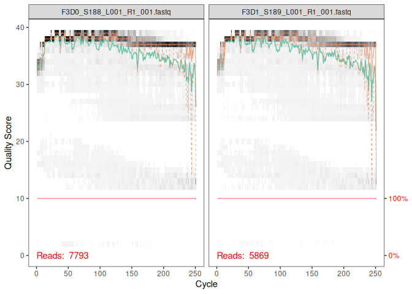
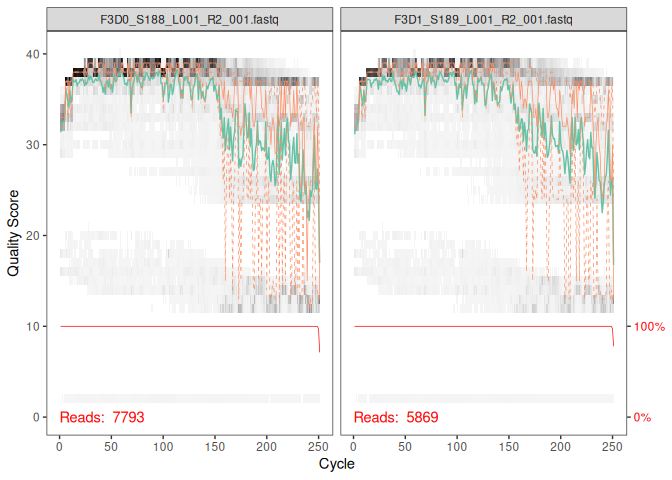
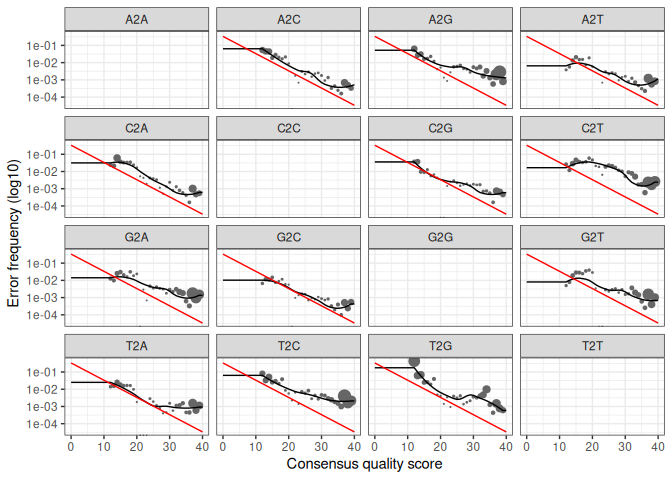

Tutoriel Dada2
================

Le metabarcoding est une méthode expérimentale permettant d’étudier la
composition d’une communauté microbienne en prélevant de l’ADN
environnemental. Suite à une amplification et un séquençage haut débit
des régions choisies, il est nécessaire de faire un traitement
bio-informatique pour analyser les données.

Dada2 est justement utilisé dans ce but, sous forme de package dans R.
Il s’agit d’un pipeline, donc une suite d’étapes réalisées dans un ordre
précis. Le but de Dada2 est, à partir des fichiers bruts FastQ,
d’identifier les ASV (soit les séquences exactes des régions amplifiées)
via un modèle d’erreur. Suite à l’obtention des ASV, toujours avec
Dada2, il va être possible de leur assigner une taxonomie. Avec un autre
package : phyloseq, il est possible d’aller plus loin avec les données
obtenues avec Dada2, comme une comparaison des communautés microbiennes.

Les données utilisées ici pour cette démonstration de Dada2 et de
phyloseq proviennent de l’étude Kozich et al. (2013). Cette étude décrit
la mise au point d’une nouvelle stratégie de séquençage Illumina MiSeq
adaptée à l’analyse du gène codant l’ARNr 16S : le séquençage Illumina
MiSeq pair-end à double index. Le jeu de données provient d’échantillons
fécaux de souris où les régions V4 de l’ARN16s ont été amplifiées puis
séquencées (séquençage haut débit Illumina MiSeq). En plus de ces
échantillons fécaux, il y a également une communauté Mock qui a été
séquencée. Cette communauté Mock sert de témoin positif dans le
traitement de données puisque sa composition en microorganismes est
connue.

``` r
library(dada2); packageVersion("dada2")
```

    ## Loading required package: Rcpp

    ## [1] '1.40.0'

1)  Première étape de la démonstration de Dada 2 :

- la récupération des fichiers FastQ de l’étude.

``` r
path <- "/home/rstudio/Dada2 Lilou/MiSeq_SOP"
list.files(path) #afin de voir les fichiers téléchargés
```

    ##  [1] "F3D0_S188_L001_R1_001.fastq"   "F3D0_S188_L001_R2_001.fastq"  
    ##  [3] "F3D1_S189_L001_R1_001.fastq"   "F3D1_S189_L001_R2_001.fastq"  
    ##  [5] "F3D141_S207_L001_R1_001.fastq" "F3D141_S207_L001_R2_001.fastq"
    ##  [7] "F3D142_S208_L001_R1_001.fastq" "F3D142_S208_L001_R2_001.fastq"
    ##  [9] "F3D143_S209_L001_R1_001.fastq" "F3D143_S209_L001_R2_001.fastq"
    ## [11] "F3D144_S210_L001_R1_001.fastq" "F3D144_S210_L001_R2_001.fastq"
    ## [13] "F3D145_S211_L001_R1_001.fastq" "F3D145_S211_L001_R2_001.fastq"
    ## [15] "F3D146_S212_L001_R1_001.fastq" "F3D146_S212_L001_R2_001.fastq"
    ## [17] "F3D147_S213_L001_R1_001.fastq" "F3D147_S213_L001_R2_001.fastq"
    ## [19] "F3D148_S214_L001_R1_001.fastq" "F3D148_S214_L001_R2_001.fastq"
    ## [21] "F3D149_S215_L001_R1_001.fastq" "F3D149_S215_L001_R2_001.fastq"
    ## [23] "F3D150_S216_L001_R1_001.fastq" "F3D150_S216_L001_R2_001.fastq"
    ## [25] "F3D2_S190_L001_R1_001.fastq"   "F3D2_S190_L001_R2_001.fastq"  
    ## [27] "F3D3_S191_L001_R1_001.fastq"   "F3D3_S191_L001_R2_001.fastq"  
    ## [29] "F3D5_S193_L001_R1_001.fastq"   "F3D5_S193_L001_R2_001.fastq"  
    ## [31] "F3D6_S194_L001_R1_001.fastq"   "F3D6_S194_L001_R2_001.fastq"  
    ## [33] "F3D7_S195_L001_R1_001.fastq"   "F3D7_S195_L001_R2_001.fastq"  
    ## [35] "F3D8_S196_L001_R1_001.fastq"   "F3D8_S196_L001_R2_001.fastq"  
    ## [37] "F3D9_S197_L001_R1_001.fastq"   "F3D9_S197_L001_R2_001.fastq"  
    ## [39] "filtered"                      "HMP_MOCK.v35.fasta"           
    ## [41] "Mock_S280_L001_R1_001.fastq"   "Mock_S280_L001_R2_001.fastq"  
    ## [43] "mouse.dpw.metadata"            "mouse.time.design"            
    ## [45] "stability.batch"               "stability.files"

Durant le séquençage pair-end, les séquences amplifiées sont lu à leurs
2 extremités. A la fin du séquençage, 2 reads (Forward et Reverse)
complémentaires sont obtenus pour chaque séquence.

En regardant les fichiers FastQ, les reads forward finissent par
“\_R1_001.fastq” et les reverse : “\_R2_001.fastq”. La première étape
sert donc à séparer les 2 types de séquences pour les analyser
séparément.

``` r
fnFs <- sort(list.files(path, pattern="_R1_001.fastq", full.names = TRUE))
fnRs <- sort(list.files(path, pattern="_R2_001.fastq", full.names = TRUE))

sample.names <- sapply(strsplit(basename(fnFs), "_"), `[`, 1)
```

2)  Les profils de qualité : Les Qscores sont obtenus durant le
    séquençage et sont contenus dans les fichiers FastQ. Durant le
    séquençage, les reads peuvent contenir des erreurs de séquençage,
    comme l’attribution d’une mauvaise base. Chaque base identifiée est
    accompagnée d’un Q-score permettant d’estimer la « fiabilité » d’une
    base. Ces profils de qualité permettent de visualiser la
    distribution des Qscores de qualité donnés à chaque base des reads
    séquencés.

La fonction plotQualityProfile permet de visualiser ce profil de
qualité. L’axe vertical montre le Q-Score des bases et l’axe horizontal,
leur position. Plus le score est élevé, plus la base attribuée lors du
séquençage est fiable, et inversement.

1)  Le profil de qualité des reads forward :

``` r
plotQualityProfile(fnFs[1:2]) 
```

<!-- --> Via ces
profils : les Q-scores des reads forward restent globalement élevé,
puisqu’il est majoritairement supérieurs à 30 signifiant que les reads
obtenus sont assez fiables. Cependant, il est possible d’observer une
baisse des Q-scores après environ 220 bases, soit vers l’extrémité, ce
qui reste donc correct pour la suite des analyses.

2)  Le profil de qualité des reads reverse :

``` r
plotQualityProfile(fnRs[1:2])
```

<!-- --> Les Qscores
des reads reverse sont globalement bons puisqu’élevés jusqu’à environ la
160ème base cependant, les Qscores se dégradent. En comprant les profils
de qualité des reads forward et reverse, les reads reverse sont
globalement moins fiables que les reads forward. Cela peut s’expliquer
par le séquençage puisque, afin de lire les séquences reverse, cela
nécessite des étapes supplémentaires pouvant diminuer la taille des
clusters, l’intensité de la fluorescence, etc.

Cette étape va également servir à choisir où tronquer/couper pour
l’étape de filtrage : 3) Filtrage

Création des fichiers filtrés :

``` r
# Place filtered files in filtered/ subdirectory
filtFs <- file.path(path, "filtered", paste0(sample.names, "_F_filt.fastq.gz"))
filtRs <- file.path(path, "filtered", paste0(sample.names, "_R_filt.fastq.gz"))
names(filtFs) <- sample.names
names(filtRs) <- sample.names
```

A partir des informations observées sur les profils de qualité, les
reads vont être filtrés et coupés afin de supprimer les reads les moins
fiables.

La fonction filterAndTrim va permettre de filtrer les reads. A
l’interieur de cette fonction, truncLen permet de définir à partir de
quelle base nos reads vont être coupés (là où les profils de qualité se
dégradent). Ici, les reads forward vont être coupés à 240 et les
reverses à 160, il est nécessaire de garder une marge de sécurité pour
être sûr que les bases reverses et forward se chevauchent. En plus de
trunclen,maxN = 0 permet de supprimer les bases indéterminées et maxEE
permet de déterminer le maximum d’erreurs attendues, calculées à partir
des Q-scores (ici 2 pour le forward et 2 pour reverse).

``` r
out <- filterAndTrim(fnFs, filtFs, fnRs, filtRs, truncLen=c(240,160),
              maxN=0, maxEE=c(2,2), truncQ=2, rm.phix=TRUE,
              compress=TRUE, multithread=FALSE) 
head(out) #permet d'afficher le tableau des 6 premiers fichiers FastQ filtrer et couper, il est donc possible de savoir combien de reads sont supprimés.
```

    ##                               reads.in reads.out
    ## F3D0_S188_L001_R1_001.fastq       7793      7113
    ## F3D1_S189_L001_R1_001.fastq       5869      5299
    ## F3D141_S207_L001_R1_001.fastq     5958      5463
    ## F3D142_S208_L001_R1_001.fastq     3183      2914
    ## F3D143_S209_L001_R1_001.fastq     3178      2941
    ## F3D144_S210_L001_R1_001.fastq     4827      4312

4)  Les erreurs de séquençage :

A partir des données précédentes, un modèle statistique d’erreurs va
être créé afin d’estimer la fréquence des possibles erreurs de
séquençage, notamment les changements de bases au sein des reads. Les
profils de qualité des reads reverse et forward étant différents, il est
nécessaire d’établir 2 modèles statistiques d’erreurs. Ces modèles vont
comparer les taux d’erreurs observés dans les données à partir des
Qscores, le taux d’erreur estimé par dada2 et le taux théorique attendu.

Pour les forward :

``` r
errF <- learnErrors(filtFs, multithread=TRUE)
```

    ## 33514080 total bases in 139642 reads from 20 samples will be used for learning the error rates.

Pour les Reverse :

``` r
errR <- learnErrors(filtRs, multithread=TRUE)
```

    ## 22342720 total bases in 139642 reads from 20 samples will be used for learning the error rates.

- vérification du modèle d’erreur :

``` r
plotErrors(errF, nominalQ=TRUE)
```

    ## Warning in scale_y_log10(): log-10 transformation introduced infinite values.

    ## Warning: Removed 164 rows containing missing values or values outside the scale range
    ## (`geom_line()`).
    ## Removed 164 rows containing missing values or values outside the scale range
    ## (`geom_line()`).

<!-- --> Ces
graphiques permettent de correspondre aux changements de bases possibles
(G lu comme un T, etc.).

La fréquence d’erreurs en lien avec le Qscore (les points noirs) doit
suivre la même tendance que les fréquences d’erreurs observées (la
courbe noire).

Ensuite, la fonction suivante va appliquer le modèle d’erreur précédent
sur les reads, puis déterminer les ASV à partir des reads « sans erreur
».

``` r
dadaFs <- dada(filtFs, err=errF, multithread=TRUE)
```

    ## Sample 1 - 7113 reads in 1979 unique sequences.
    ## Sample 2 - 5299 reads in 1639 unique sequences.
    ## Sample 3 - 5463 reads in 1477 unique sequences.
    ## Sample 4 - 2914 reads in 904 unique sequences.
    ## Sample 5 - 2941 reads in 939 unique sequences.
    ## Sample 6 - 4312 reads in 1267 unique sequences.
    ## Sample 7 - 6741 reads in 1756 unique sequences.
    ## Sample 8 - 4560 reads in 1438 unique sequences.
    ## Sample 9 - 15637 reads in 3590 unique sequences.
    ## Sample 10 - 11413 reads in 2762 unique sequences.
    ## Sample 11 - 12017 reads in 3021 unique sequences.
    ## Sample 12 - 5032 reads in 1566 unique sequences.
    ## Sample 13 - 18075 reads in 3707 unique sequences.
    ## Sample 14 - 6250 reads in 1479 unique sequences.
    ## Sample 15 - 4052 reads in 1195 unique sequences.
    ## Sample 16 - 7369 reads in 1832 unique sequences.
    ## Sample 17 - 4765 reads in 1183 unique sequences.
    ## Sample 18 - 4871 reads in 1382 unique sequences.
    ## Sample 19 - 6504 reads in 1709 unique sequences.
    ## Sample 20 - 4314 reads in 897 unique sequences.

``` r
dadaRs <- dada(filtRs, err=errR, multithread=TRUE)
```

    ## Sample 1 - 7113 reads in 1660 unique sequences.
    ## Sample 2 - 5299 reads in 1349 unique sequences.
    ## Sample 3 - 5463 reads in 1335 unique sequences.
    ## Sample 4 - 2914 reads in 853 unique sequences.
    ## Sample 5 - 2941 reads in 880 unique sequences.
    ## Sample 6 - 4312 reads in 1286 unique sequences.
    ## Sample 7 - 6741 reads in 1803 unique sequences.
    ## Sample 8 - 4560 reads in 1265 unique sequences.
    ## Sample 9 - 15637 reads in 3414 unique sequences.
    ## Sample 10 - 11413 reads in 2522 unique sequences.
    ## Sample 11 - 12017 reads in 2771 unique sequences.
    ## Sample 12 - 5032 reads in 1415 unique sequences.
    ## Sample 13 - 18075 reads in 3290 unique sequences.
    ## Sample 14 - 6250 reads in 1390 unique sequences.
    ## Sample 15 - 4052 reads in 1134 unique sequences.
    ## Sample 16 - 7369 reads in 1635 unique sequences.
    ## Sample 17 - 4765 reads in 1084 unique sequences.
    ## Sample 18 - 4871 reads in 1161 unique sequences.
    ## Sample 19 - 6504 reads in 1502 unique sequences.
    ## Sample 20 - 4314 reads in 732 unique sequences.

contrôle :

``` r
dadaFs[[1]]
```

    ## dada-class: object describing DADA2 denoising results
    ## 128 sequence variants were inferred from 1979 input unique sequences.
    ## Key parameters: OMEGA_A = 1e-40, OMEGA_C = 1e-40, BAND_SIZE = 16

Via cette ligne de code, il est possible de savoir que pour le premier
échantillon, qu’à partir des reads Forward, 128 ASV ont observé suite à
l’application du modèle d’erreur et au regroupement de reads.

``` r
dadaRs[[1]]
```

    ## dada-class: object describing DADA2 denoising results
    ## 119 sequence variants were inferred from 1660 input unique sequences.
    ## Key parameters: OMEGA_A = 1e-40, OMEGA_C = 1e-40, BAND_SIZE = 16

Pour les reads Reverse : 119 ASV, toujours pour le premier échantillon.

Cependant, ce ne sont pas les ASV finales puisqu’il est nécessaire de
fusionner les reads forward et reverse.

5)  Fusion des fréquences reverse et Forward La fonction mergePairs va
    permettre de reconstituer les ASV à partir des reads. La fonction
    mergePairs va associer les reads reverse et forward du même fragment
    en remettant reverse dans le bon « sens ». De plus, cette fonction
    exige un chevauchement d’au moins 12 nucléotides pour que les reads
    soient fusionnés.

``` r
mergers <- mergePairs(dadaFs, filtFs, dadaRs, filtRs, verbose=TRUE)
```

    ## 6540 paired-reads (in 107 unique pairings) successfully merged out of 6891 (in 197 pairings) input.

    ## 5028 paired-reads (in 101 unique pairings) successfully merged out of 5190 (in 157 pairings) input.

    ## 4986 paired-reads (in 81 unique pairings) successfully merged out of 5267 (in 166 pairings) input.

    ## 2595 paired-reads (in 52 unique pairings) successfully merged out of 2754 (in 108 pairings) input.

    ## 2553 paired-reads (in 60 unique pairings) successfully merged out of 2785 (in 119 pairings) input.

    ## 3646 paired-reads (in 55 unique pairings) successfully merged out of 4109 (in 157 pairings) input.

    ## 6079 paired-reads (in 81 unique pairings) successfully merged out of 6514 (in 198 pairings) input.

    ## 3968 paired-reads (in 91 unique pairings) successfully merged out of 4388 (in 187 pairings) input.

    ## 14233 paired-reads (in 143 unique pairings) successfully merged out of 15355 (in 352 pairings) input.

    ## 10528 paired-reads (in 120 unique pairings) successfully merged out of 11165 (in 278 pairings) input.

    ## 11154 paired-reads (in 137 unique pairings) successfully merged out of 11797 (in 298 pairings) input.

    ## 4349 paired-reads (in 85 unique pairings) successfully merged out of 4802 (in 179 pairings) input.

    ## 17431 paired-reads (in 153 unique pairings) successfully merged out of 17812 (in 272 pairings) input.

    ## 5850 paired-reads (in 81 unique pairings) successfully merged out of 6095 (in 159 pairings) input.

    ## 3716 paired-reads (in 86 unique pairings) successfully merged out of 3894 (in 147 pairings) input.

    ## 6865 paired-reads (in 99 unique pairings) successfully merged out of 7191 (in 187 pairings) input.

    ## 4426 paired-reads (in 67 unique pairings) successfully merged out of 4603 (in 127 pairings) input.

    ## 4576 paired-reads (in 101 unique pairings) successfully merged out of 4739 (in 174 pairings) input.

    ## 6092 paired-reads (in 109 unique pairings) successfully merged out of 6315 (in 173 pairings) input.

    ## 4269 paired-reads (in 20 unique pairings) successfully merged out of 4281 (in 28 pairings) input.

``` r
head(mergers[[1]])
```

    ##                                                                                                                                                                                                                                                       sequence
    ## 1 TACGGAGGATGCGAGCGTTATCCGGATTTATTGGGTTTAAAGGGTGCGCAGGCGGAAGATCAAGTCAGCGGTAAAATTGAGAGGCTCAACCTCTTCGAGCCGTTGAAACTGGTTTTCTTGAGTGAGCGAGAAGTATGCGGAATGCGTGGTGTAGCGGTGAAATGCATAGATATCACGCAGAACTCCGATTGCGAAGGCAGCATACCGGCGCTCAACTGACGCTCATGCACGAAAGTGTGGGTATCGAACAGG
    ## 2 TACGGAGGATGCGAGCGTTATCCGGATTTATTGGGTTTAAAGGGTGCGTAGGCGGCCTGCCAAGTCAGCGGTAAAATTGCGGGGCTCAACCCCGTACAGCCGTTGAAACTGCCGGGCTCGAGTGGGCGAGAAGTATGCGGAATGCGTGGTGTAGCGGTGAAATGCATAGATATCACGCAGAACCCCGATTGCGAAGGCAGCATACCGGCGCCCTACTGACGCTGAGGCACGAAAGTGCGGGGATCAAACAGG
    ## 3 TACGGAGGATGCGAGCGTTATCCGGATTTATTGGGTTTAAAGGGTGCGTAGGCGGGCTGTTAAGTCAGCGGTCAAATGTCGGGGCTCAACCCCGGCCTGCCGTTGAAACTGGCGGCCTCGAGTGGGCGAGAAGTATGCGGAATGCGTGGTGTAGCGGTGAAATGCATAGATATCACGCAGAACTCCGATTGCGAAGGCAGCATACCGGCGCCCGACTGACGCTGAGGCACGAAAGCGTGGGTATCGAACAGG
    ## 4 TACGGAGGATGCGAGCGTTATCCGGATTTATTGGGTTTAAAGGGTGCGTAGGCGGGCTTTTAAGTCAGCGGTAAAAATTCGGGGCTCAACCCCGTCCGGCCGTTGAAACTGGGGGCCTTGAGTGGGCGAGAAGAAGGCGGAATGCGTGGTGTAGCGGTGAAATGCATAGATATCACGCAGAACCCCGATTGCGAAGGCAGCCTTCCGGCGCCCTACTGACGCTGAGGCACGAAAGTGCGGGGATCGAACAGG
    ## 5 TACGGAGGATGCGAGCGTTATCCGGATTTATTGGGTTTAAAGGGTGCGCAGGCGGACTCTCAAGTCAGCGGTCAAATCGCGGGGCTCAACCCCGTTCCGCCGTTGAAACTGGGAGCCTTGAGTGCGCGAGAAGTAGGCGGAATGCGTGGTGTAGCGGTGAAATGCATAGATATCACGCAGAACTCCGATTGCGAAGGCAGCCTACCGGCGCGCAACTGACGCTCATGCACGAAAGCGTGGGTATCGAACAGG
    ## 6 TACGGAGGATGCGAGCGTTATCCGGATTTATTGGGTTTAAAGGGTGCGTAGGCGGGATGCCAAGTCAGCGGTAAAAAAGCGGTGCTCAACGCCGTCGAGCCGTTGAAACTGGCGTTCTTGAGTGGGCGAGAAGTATGCGGAATGCGTGGTGTAGCGGTGAAATGCATAGATATCACGCAGAACTCCGATTGCGAAGGCAGCATACCGGCGCCCTACTGACGCTGAGGCACGAAAGCGTGGGTATCGAACAGG
    ##   abundance forward reverse nmatch nmismatch nindel prefer accept
    ## 1       579       1       1    148         0      0      1   TRUE
    ## 2       470       2       2    148         0      0      2   TRUE
    ## 3       449       3       4    148         0      0      1   TRUE
    ## 4       430       4       3    148         0      0      2   TRUE
    ## 5       345       5       6    148         0      0      1   TRUE
    ## 6       282       6       5    148         0      0      2   TRUE

- regroupement des séquences fusionnées :

``` r
seqtab <- makeSequenceTable(mergers)
dim(seqtab) #donne la dimension du tableau obtenu 
```

    ## [1]  20 293

Ainsi, 20 lignes sont obtenues donc 20 échantillons avec 293 colonnes
correspondant au nombre de séquences pour chaque échantillon. Cependant,
il est nécessaire de vérifier que la longueur obtenue suite à ces
traitements correspond à celle attendue pour ici la région V4 du gène
16s.

``` r
table(nchar(getSequences(seqtab)))
```

    ## 
    ## 251 252 253 254 255 
    ##   1  88 196   6   2

5)  Traitement des chimères : Les chimères sont des séquences fausses
    produites durant la PCR à partir de fragments provenant de 2
    séquences différentes. Il est donc nécessaire de les supprimer afin
    de ne pas fausser le résultat. Le programme suivant va donc
    rechercher les chimères dans chaque échantillon et les supprimer.

``` r
seqtab.nochim <- removeBimeraDenovo(seqtab, method="consensus", multithread=TRUE, verbose=TRUE)
```

    ## Identified 61 bimeras out of 293 input sequences.

``` r
dim(seqtab.nochim)
```

    ## [1]  20 232

suite à la fusion des reads reverse et forward, 293 colonnes ont été
obtenu. Suite au retrait des chimères, il y a maintenant 232 colonnes
soit 232 ASV.

Calcul du pourcentage de reads conservés :

``` r
sum(seqtab.nochim)/sum(seqtab)*100
```

    ## [1] 96.40374

ici 96.40% des reads ont été conservés et qu’environ 3.60% ont été
considéré comme des chimères.

6)  Vérification des étapes Ici, il s’agit d’un contrôle/bilan de toutes
    les étapes précédentes pour être sûre de garder un maximum de
    données brutes et qu’il n’y est pas de pertes excessives entre les
    différentes étapes.

``` r
getN <- function(x) sum(getUniques(x))
track <- cbind(out, sapply(dadaFs, getN), sapply(dadaRs, getN), sapply(mergers, getN), rowSums(seqtab.nochim))
# If processing a single sample, remove the sapply calls: e.g. replace sapply(dadaFs, getN) with getN(dadaFs)
colnames(track) <- c("input", "filtered", "denoisedF", "denoisedR", "merged", "nonchim")
rownames(track) <- sample.names
head(track)
```

    ##        input filtered denoisedF denoisedR merged nonchim
    ## F3D0    7793     7113      6976      6979   6540    6528
    ## F3D1    5869     5299      5227      5239   5028    5017
    ## F3D141  5958     5463      5331      5357   4986    4863
    ## F3D142  3183     2914      2799      2830   2595    2521
    ## F3D143  3178     2941      2822      2868   2553    2519
    ## F3D144  4827     4312      4151      4228   3646    3507

La diminution du nombre de reads au fur et à mesure des étapes est
observé grâce à ce tableau. Au vu de ces 6 premières lignes, il n’y a
pas de perte extrême entre certaines étapes.

7)  Attribution taxonomique :

A partir des étapes précédentes, la répartition des 232 ASV dans les 20
échantillons est connue. Il reste maintenant l’étape de leur attribuer
une taxonomie en se basant sur la base de données silva. La fonction
assigntaxonomy va attribuer une classification taxonomique des séquences
finales.

``` r
taxa <- assignTaxonomy(seqtab.nochim, "/home/rstudio/Dada2 Lilou/silva_nr99_v138.2_toGenus_trainset.fa.gz", multithread=TRUE)
# via wget -O silva_nr99_v138.2_toGenus_trainset.fa.gz "https://zenodo.org/records/14169026/files/silva_nr99_v138.2_toGenus_trainset.fa.gz?download=1" dans le terminal
taxa.print <- taxa 
rownames(taxa.print) <- NULL
head(taxa.print)#affiche l'assignation taxo
```

    ##      Kingdom    Phylum         Class         Order           Family          
    ## [1,] "Bacteria" "Bacteroidota" "Bacteroidia" "Bacteroidales" "Muribaculaceae"
    ## [2,] "Bacteria" "Bacteroidota" "Bacteroidia" "Bacteroidales" "Muribaculaceae"
    ## [3,] "Bacteria" "Bacteroidota" "Bacteroidia" "Bacteroidales" "Muribaculaceae"
    ## [4,] "Bacteria" "Bacteroidota" "Bacteroidia" "Bacteroidales" "Muribaculaceae"
    ## [5,] "Bacteria" "Bacteroidota" "Bacteroidia" "Bacteroidales" "Bacteroidaceae"
    ## [6,] "Bacteria" "Bacteroidota" "Bacteroidia" "Bacteroidales" "Muribaculaceae"
    ##      Genus        
    ## [1,] NA           
    ## [2,] NA           
    ## [3,] NA           
    ## [4,] NA           
    ## [5,] "Bacteroides"
    ## [6,] NA

Le résultat montre que 5 des premiers ASV font partie de la famille des
Muribaculaceae et un autre de la famille Bacteroidaceae plus précisément
du genre des Bacteroides.

8)  Evaluation de la précision de dada2

Afin d’évaluer la précision de Dada2 et d’être sûr que les ASV sont
correct, la communauté Mock va être utilisé.

- sélection des ASV présentes dans le mock :

``` r
unqs.mock <- seqtab.nochim["Mock",]
unqs.mock <- sort(unqs.mock[unqs.mock>0], decreasing=TRUE) # Drop ASVs absent in the Mock
cat("DADA2 inferred", length(unqs.mock), "sample sequences present in the Mock community.\n")
```

    ## DADA2 inferred 20 sample sequences present in the Mock community.

Le pipeline a pu détecter 20 ASV différent dans l’échantillon Mock. Il
faut maintenant cherché ces ASV détectés dans Mock dans les ASV obtenus
suite au traitement de dada2

``` r
mock.ref <- getSequences(file.path(path, "HMP_MOCK.v35.fasta"))
match.ref <- sum(sapply(names(unqs.mock), function(x) any(grepl(x, mock.ref))))
cat("Of those,", sum(match.ref), "were exact matches to the expected reference sequences.\n")
```

    ## Of those, 20 were exact matches to the expected reference sequences.

Suite à cette comparaison, les 20 ASV du mock dans le jeu de donnée
correspondent au fichier de référence. Dada 2 a produit des ASV fiables
et leur a attribué des taxonomies. Pour les analyser et visualiser les
données.

\*\*\*avec cette nouvelle vm, je n’ai pas pu télécharger le package
phyloseq, je pense que cela est dû au droit d’administrateur puisque je
n’ai pas le droit d’executer et donc d’installer les packages. Avec ma
précédente vm, j’ai pu aller jusqu’à la fin, je suis donc capable
d’expliquer ce que fait chaque étape seulement je n’obtiens pas les
graphiques. De plus, étant donné que je n’ai pas pu télécharger les
packages etc, je ne peux pas mettre sous forme de chunk le prgramme pour
phyloseq

9)  Phyloseq A. chargement des packages

library(phyloseq); packageVersion(“phyloseq”) library(Biostrings);
packageVersion(“Biostrings”) library(ggplot2); packageVersion(“ggplot2”)
theme_set(theme_bw())

B. Récupération des métadonnées Afin de mieux analyser les données, il
est nécessaire de récupérer les métadonnées en lien avec la description
du jeu de donnée. Les métadonnées présentes ici, en lien toujours avec
l’étude Kozich et al. (2013) : - l’identifiant de la souris - son
genre - le nombre de jours après le sevrage - les prélèvements avant
(avant les 100J) ou après sevrage (aprés les 100j)

**samples.out \<- rownames(seqtab.nochim) subject \<-
sapply(strsplit(samples.out, “D”), `[`, 1) gender \<-
substr(subject,1,1) subject \<- substr(subject,2,999) day \<-
as.integer(sapply(strsplit(samples.out, “D”), `[`, 2)) samdf \<-
data.frame(Subject=subject, Gender=gender, Day=day)
samdf$When <- "Early"
samdf$When\[samdf\$Day\>100\] \<- “Late” rownames(samdf) \<-
samples.out**

C. Rassemblement des données La fonction phyloseq va permettre de
rassembler les données obtenues durant Dada2 comme les ASV, leur
classification taxonomique ainsi que les métadonnées assigner
précédemment tout en excluant les données de la communauté Mock.

\*\* ps \<- phyloseq(otu_table(seqtab.nochim, taxa_are_rows=FALSE),
sample_data(samdf), tax_table(taxa)) ps \<-
prune_samples(sample_names(ps) != “Mock”, ps)

\#il est également important de renommer les ASVs pour que lors de la
visualisation en graphique ce ne soit pas leur séquence nucléotidique

dna \<- Biostrings::DNAStringSet(taxa_names(ps)) names(dna) \<-
taxa_names(ps) ps \<- merge_phyloseq(ps, dna) taxa_names(ps) \<-
paste0(“ASV”, seq(ntaxa(ps))) ps \*\*

D. Analyse de l’Alpha diversité. L’alpha diversité permet d’analyser la
diversité au sein d’un seul échantillon. Les indices d’alpha diversité
sont Shannon et Simpson. - Indice de shannon : permet de s’intéresser au
ASV rare soit la richesse globale dans l’échantillon - Indice de simpson
: permet de s’intéresser au ASV les plus abondantes et à leur dominance

**plot_richness(ps, x=“Day”, measures=c(“Shannon”, “Simpson”),
color=“When”)**

Cependant, cette comparaison des 2 indices ne permet pas de faire une
comparaison par rapport à la composition en ASV des différents
échantillons.

E. Analyse de la Beta diversité : Suite à l’indice d’alpha diversité, il
est nécessaire de regarder la beta diversité soit la comparaison de la
composition en ASv de 2 échantillons. Ici, l’indice de Bray-Curtis
permet d’analyser cette diversité, il va prendre les ASv partagés, les
ASV différentes et leur abondance relative.

**\# Transform data to proportions as appropriate for Bray-Curtis
distances ps.prop \<- transform_sample_counts(ps, function(otu)
otu/sum(otu)) ord.nmds.bray \<- ordinate(ps.prop, method=“NMDS”,
distance=“bray”) plot_ordination(ps.prop, ord.nmds.bray, color=“When”,
title=“Bray NMDS”)**

F. Visualisation des ASV L’objectif ici de visualiser les 20 ASV les
plus abondantes afin d’identifier les familles bactériennes dominantes
et de comparer les 2 périodes early et late.

**top20 \<- names(sort(taxa_sums(ps), decreasing=TRUE))\[1:20\] ps.top20
\<- transform_sample_counts(ps, function(OTU) OTU/sum(OTU)) ps.top20 \<-
prune_taxa(top20, ps.top20) plot_bar(ps.top20, x=“Day”, fill=“Family”) +
facet_wrap(~When, scales=“free_x”)**

10) Conclusion Cette démonstration des différentes étapes de DADA2 a
    permis de transformer des données brutes issues d’un séquençage
    Illumina MiSeq pair end à des ASV fiables ainsi que leur attribution
    taxonomique. De plus, le package phyloseq permet une meilleure
    analyse de ces ASV avec l’ajout des métadonnées. Ce package permet
    également une meilleure visualisation des données comme celle des
    indices, mais aussi un graphique montrant les familles de bactéries
    dominantes en fonction des périodes de prélèvements menant à
    l’interprétation de nos données.
